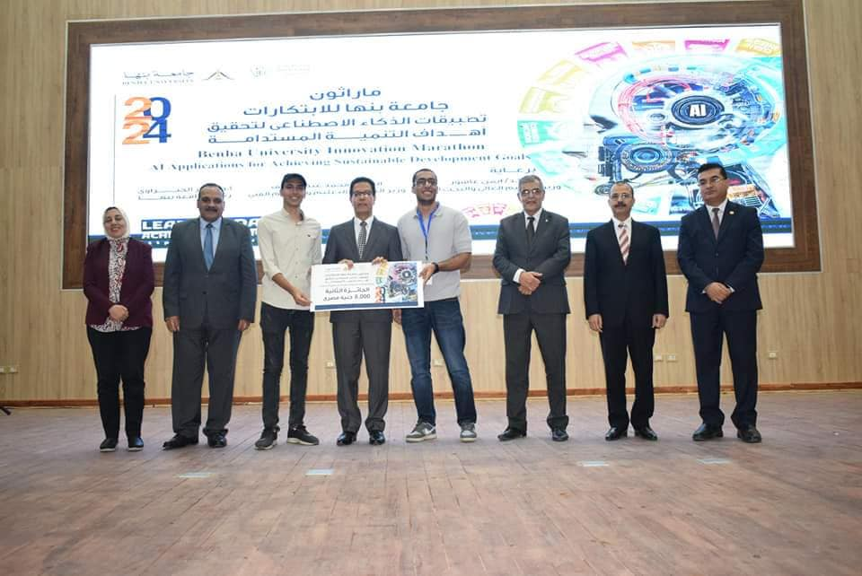
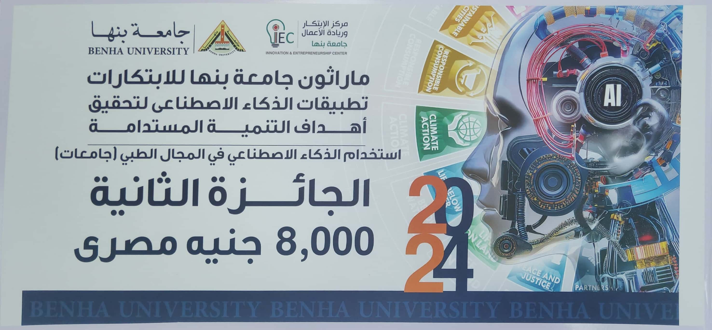
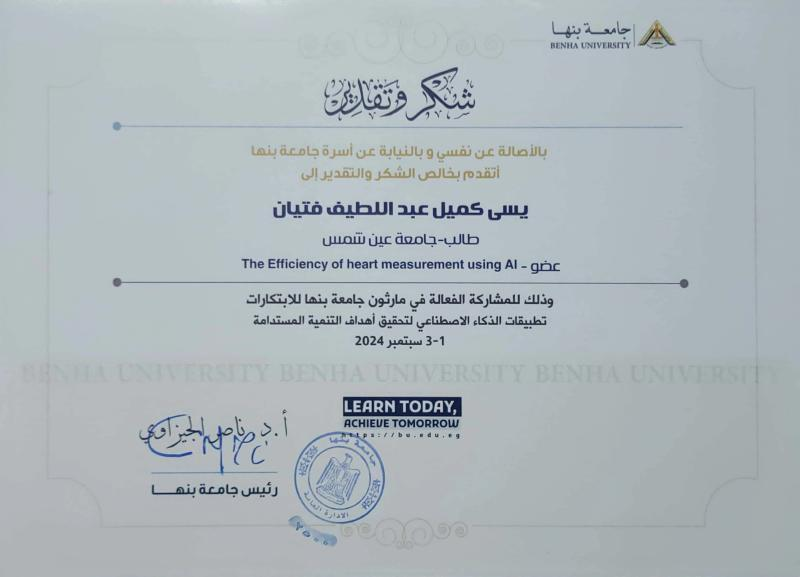
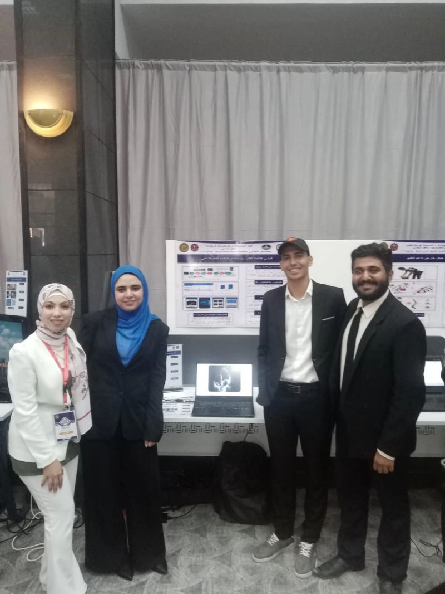
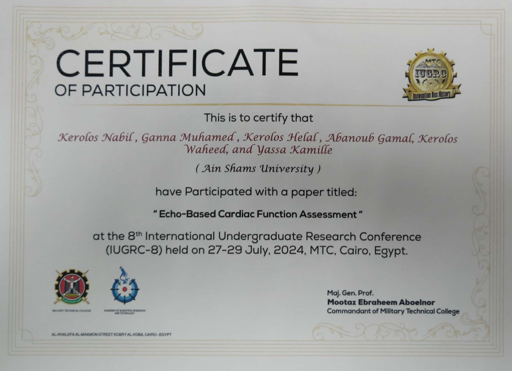

# Echo-Based Cardiac Function Assessment   `Graduation Project 2024`

- `The goal of this project is to create a sophisticated Deep Learning system that can quickly and accurately evaluate Left Ventricle Ejection Fraction (LVEF), enhancing the diagnosis and management of cardiovascular diseases.` 
- `Precise LVEF assessment is vital for forecasting the prognosis in conditions such as congestive heart failure, yet existing techniques are often slow and lack precision.`

# System Architecture  

# Before using this repo
> you can use Kaggle Notebook directly from <a href="https://www.kaggle.com/code/abanoubgamal/gp-notebook"> HERE </a>.

You will need to request access to the 
<a href = 'https://echonet.github.io/dynamic'>EchoNet-Dynamic</a>
dataset from Stanford University.  
Once you have access to the data, download it and write the path of the "EchoNet-Dynamic" folder in the _dataRootPath variable in
<a href = "/Model/Paths.py">Paths</a>.

<pre>
EchoNet-Dynamic Dataset
├── FileList.csv
├── VolumeTracings.csv
└── Videos
    ├── 0X1A0A263B22CCD966.avi
    ├── 0X1A2A76BDB5B98BED.avi
    ├── 0X1A2C60147AF9FDAE.avi
    └── etc.
</pre>

# Train Models
- train this model from 
 <a href = "/Model/Main.py">Main</a>
and choose one model to train each time.

1) ResNet-Bert Transformer HyperModel:
- Detecting (ES-ED) Frames   

2) U-Net Model:
- Detecting Left Ventricle   

# Test Models
- Add the Model Pathts in <a href = "/Model/Paths.py">Paths</a>  
You can find All Models here:  
        - <a href = https://www.kaggle.com/models/abanoubgamal/u-net/Keras/transformer/1> HyperModel </a> Download best.pt   
        - <a href = https://www.kaggle.com/models/abanoubgamal/u-net/Keras/ed/1> U-Net ED </a>  
        - <a href = https://www.kaggle.com/models/abanoubgamal/u-net/Keras/es/1>  U-Net ES </a>  

- Run
<a href = "/Model/Api.py"> API </a>
to open the local server using FastAPI.
- Run the <a href = "/GUI"> GUI </a>
file using Flutter.

# Team Members
- Abanoub Gamal
- Kerolos Nabil
- Kerolos Helal
- Kerolos Waheed
- Yassa Kamille
- Ganna Muhammed

# Supervisors
- Dr. Manal Mohsen Tantawi
- T.A. Radwa Reda Hossieny

# Competitions & Rewards

- Secured Second Place in the AI in the Medical Field competition at Marathon Benha University 🥈.  

--------------

- Presented and published our scientific paper at the 8th International Undergraduate Research Conference (IUGRC) at the Military Technical College. Also, We participated in the Military Technical College Science Exhibition, presenting both the paper and the project in the presence of the Minister of Defense. Additionally, We Were Invited to present and test the project at the Military Technical Hospital.   

## Echo-Based Cardiac Function Assessment Workflow

```mermaid
flowchart TD

subgraph group_data["Data Preparation"]
  node_paths["Data and Model Paths<br/>[Paths.py]"]
  node_video_data["Video Annotations<br/>[VideoData.py]"]
  node_prepare["Video and Mask Preparation<br/>[HelperFunction.py]"]
  node_video_dataset["Transformer Dataset"]
end

subgraph group_training["Model Training"]
  node_training_entry["Training Selection<br/>[Main.py]"]
  node_frame_training["ED/ES Frame Model<br/>[Transformer.py]"]
  node_transformer_arch["Transformer Architecture"]
  node_resnet["ResNet Encoder<br/>[ResNetAE.py]"]
  node_unet_training["LV Segmentation Training<br/>[Unet.py]"]
  node_unet_arch["U-Net Architecture<br/>[UnetModel.py]"]
end

subgraph group_inference["Inference Service"]
  node_api["FastAPI Inference Server<br/>[Api.py]"]
  node_frame_detection["ED/ES Frame Detection<br/>[Transformer.py]"]
  node_lv_segmentation["LV Segmentation and EF"]
end

subgraph group_client["Flutter Client"]
  node_flutter["Flutter GUI<br/>[main.cpp]"]
end

node_dataset[("EchoNet Dataset")]
node_user(("Clinician / Operator"))

node_dataset -->|"Provides files"| node_paths
node_paths -->|"Configures inputs"| node_prepare
node_prepare -->|"Builds annotations"| node_video_data
node_training_entry -->|"Loads and prepares"| node_prepare
node_training_entry -->|"Trains or tests"| node_frame_training
node_training_entry -->|"Trains or tests"| node_unet_training
node_training_entry -->|"Reads model paths"| node_paths
node_frame_training -->|"Builds dataloader"| node_video_dataset
node_frame_training -->|"Instantiates model"| node_transformer_arch
node_transformer_arch -->|"Uses encoder"| node_resnet
node_unet_training -->|"Instantiates model"| node_unet_arch
node_unet_training -->|"Uses EF helpers"| node_prepare
node_user -->|"Uses client"| node_flutter
node_flutter -.->|"Requests assessment"| node_api
node_user -->|"Runs server"| node_api
node_api -->|"Uses model"| node_frame_detection
node_api -->|"Uses model"| node_lv_segmentation
node_api -->|"Loads configured models"| node_paths
node_frame_detection -->|"Extracts video frames"| node_prepare
node_lv_segmentation -->|"Loads segmentation model"| node_unet_arch

click node_paths "https://github.com/yassakamille/echo-based-cardiac-function-assessment/blob/main/Model/Paths.py"
click node_video_data "https://github.com/yassakamille/echo-based-cardiac-function-assessment/blob/main/Model/VideoData.py"
click node_prepare "https://github.com/yassakamille/echo-based-cardiac-function-assessment/blob/main/Model/HelperFunction.py"
click node_video_dataset "https://github.com/yassakamille/echo-based-cardiac-function-assessment/blob/main/Model/VideoDataSetForModel.py"
click node_training_entry "https://github.com/yassakamille/echo-based-cardiac-function-assessment/blob/main/Model/Main.py"
click node_frame_training "https://github.com/yassakamille/echo-based-cardiac-function-assessment/blob/main/Model/Transformer.py"
click node_transformer_arch "https://github.com/yassakamille/echo-based-cardiac-function-assessment/blob/main/Model/TransformerModel.py"
click node_resnet "https://github.com/yassakamille/echo-based-cardiac-function-assessment/blob/main/Model/ResNetAE.py"
click node_unet_training "https://github.com/yassakamille/echo-based-cardiac-function-assessment/blob/main/Model/Unet.py"
click node_unet_arch "https://github.com/yassakamille/echo-based-cardiac-function-assessment/blob/main/Model/UnetModel.py"
click node_api "https://github.com/yassakamille/echo-based-cardiac-function-assessment/blob/main/Model/Api.py"
click node_frame_detection "https://github.com/yassakamille/echo-based-cardiac-function-assessment/blob/main/Model/Transformer.py"
click node_lv_segmentation "https://github.com/yassakamille/echo-based-cardiac-function-assessment/blob/main/Model/Unet.py"
click node_flutter "https://github.com/yassakamille/echo-based-cardiac-function-assessment/blob/main/GUI/windows/runner/main.cpp"

classDef toneNeutral fill:#f8fafc,stroke:#334155,stroke-width:1.5px,color:#0f172a
classDef toneBlue fill:#dbeafe,stroke:#2563eb,stroke-width:1.5px,color:#172554
classDef toneAmber fill:#fef3c7,stroke:#d97706,stroke-width:1.5px,color:#78350f
classDef toneMint fill:#dcfce7,stroke:#16a34a,stroke-width:1.5px,color:#14532d
classDef toneRose fill:#ffe4e6,stroke:#e11d48,stroke-width:1.5px,color:#881337
classDef toneIndigo fill:#e0e7ff,stroke:#4f46e5,stroke-width:1.5px,color:#312e81
classDef toneTeal fill:#ccfbf1,stroke:#0f766e,stroke-width:1.5px,color:#134e4a

class node_paths,node_video_data,node_prepare,node_video_dataset toneBlue
class node_training_entry,node_frame_training,node_transformer_arch,node_resnet,node_unet_training,node_unet_arch,node_dataset toneAmber
class node_api,node_frame_detection,node_lv_segmentation toneMint
class node_flutter toneRose
class node_user toneIndigo
```

